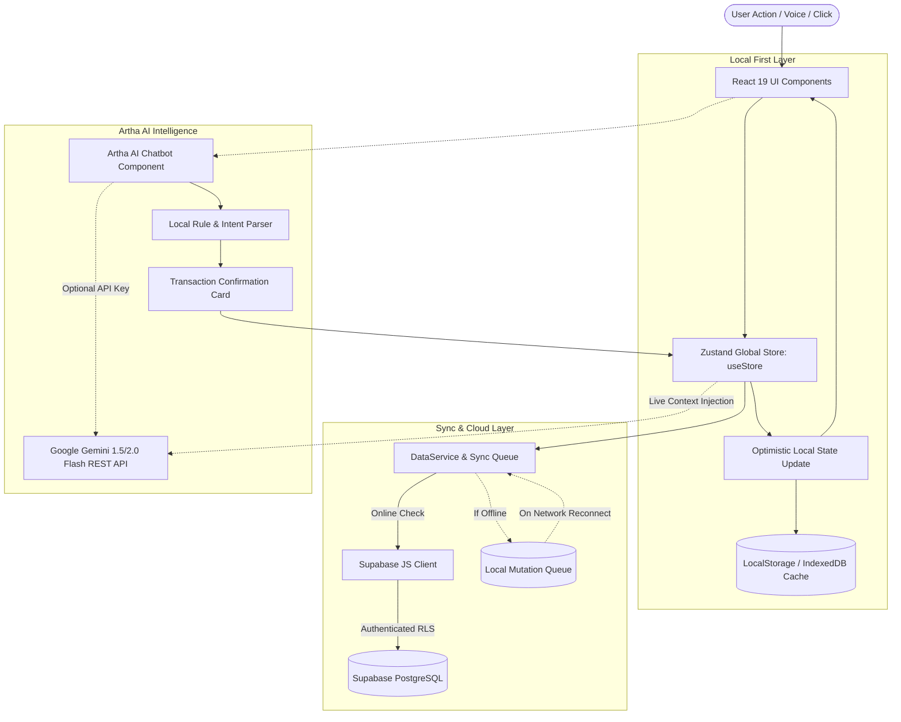

# 📚 MyMoney Personal Finance & Artha AI — Complete Project Documentation

Welcome to the comprehensive technical and operational documentation for **MyMoney**, a modern, offline-first personal wealth management Progressive Web Application (PWA) with Supabase PostgreSQL cloud sync and **Artha AI**, an embedded financial intelligence assistant.

---

## 📑 Table of Contents
1. [Project Overview & Vision](#1-project-overview--vision)
2. [Technology Stack](#2-technology-stack)
3. [Architecture & Data Flow](#3-architecture--data-flow)
4. [User Interface & Component Hierarchy](#4-user-interface--component-hierarchy)
5. [Styling, CSS System & Design Tokens](#5-styling-css-system--design-tokens)
6. [Core Features Breakdown](#6-core-features-breakdown)
7. [Artha AI Assistant Architecture](#7-artha-ai-assistant-architecture)
8. [Backend & Database Architecture (Supabase PostgreSQL)](#8-backend--database-architecture-supabase-postgresql)
9. [APIs & External Integrations](#9-apis--external-integrations)
10. [State Management & Offline Synchronization](#10-state-management--offline-synchronization)
11. [Directory Structure & Code Map](#11-directory-structure--code-map)
12. [Deployment, Build & PWA Configuration](#12-deployment-build--pwa-configuration)

---

## 1. Project Overview & Vision

**MyMoney** is engineered as a fast, private, and frictionless personal wealth manager. It addresses key pain points found in traditional budgeting apps:
* **Zero Latency**: Powered by local-first optimistic updates using Zustand and IndexedDB/localStorage caching. Every action updates instantly on screen with zero network waiting.
* **100% Offline Capability**: Built as a PWA with service workers, enabling users to log transactions and review budgets even with zero internet connectivity.
* **Seamless Cloud Sync**: Built on top of **Supabase PostgreSQL** with Row-Level Security (RLS). When online, all changes sync automatically to the cloud.
* **Embedded AI Financial Guardian (Artha AI)**: Enables natural language transaction logging (*"Spent ₹150 on coffee via UPI"*), Cleo-style spending roasts, savings hype, and open-ended financial guidance powered by Google Gemini.
* **Refined Aesthetics**: Tailored glassmorphism UI supporting both high-contrast Dark Mode and crisp Light Mode with custom scrollbars and smooth micro-animations.

---

## 2. Technology Stack

### Frontend Core
* **React 19 (`react` 19.3.1, `react-dom` 19.3.1)**: Utilizes modern React 19 paradigms, functional components, hooks, and React 19 portals.
* **TypeScript 7 (`typescript` ~7.0.2)**: Strict type safety covering data models, API payloads, Supabase schemas, and UI props.
* **Vite 8 (`vite` ^8.3.6)**: Modern build tool offering instant Hot Module Replacement (HMR) and optimized tree-shaken production bundles.
* **React Router v7 (`react-router-dom` ^7.18.5)**: Client-side routing with code-split lazy routes (`React.lazy` + `Suspense`) and responsive layouts.

### State & Utility Libraries
* **Zustand 5 (`zustand` ^5.1.0)**: Lightweight, reactive global store managing transactions, accounts, budgets, goals, recurring bills, and sync states.
* **Date-fns 4 (`date-fns` ^4.4.0)**: Modular date manipulation, ISO formatting, month calculations, and recurring schedule projections.
* **Recharts 3 (`recharts` ^3.10.1)**: Composable charting library rendering category expense pie charts and trendlines.
* **Lucide React (`lucide-react` ^1.72.0)**: Clean, uniform vector icons for categories, navigation, statuses, and AI triggers.
* **Clsx (`clsx` ^2.1.1)**: Conditional CSS class concatenation.

### Backend & Cloud
* **Supabase (`@supabase/supabase-js` ^2.119.0)**: Cloud PostgreSQL database, authentication (Email/Password), Row Level Security (RLS), and RESTful client sync.

### Styling & Build Tooling
* **Tailwind CSS v4 (`tailwindcss` ^4.3.5, `@tailwindcss/vite` ^4.3.5)**: Modern CSS engine using CSS custom variants, CSS variables, and native color schemes.
* **Vite Plugin PWA (`vite-plugin-pwa` ^2.0.0)**: Automatic service worker generation (`dist/sw.js`), asset precaching, and manifest configuration.
* **Oxlint (`oxlint` ^1.90.0)**: High-performance linter.

---

## 3. Architecture & Data Flow



---

## 4. User Interface & Component Hierarchy

### Layout System (`src/components/layout/`)
* **`AppLayout.tsx`**: Top-level wrapper managing:
  * Responsive Desktop Sidebar (`Sidebar.tsx`) vs Mobile Bottom Navigation (`BottomNav.tsx`).
  * Sticky Top Header with live time/date pill, Supabase connection indicator, intro replay trigger, alerts dropdown, and **`Ask AI`** trigger button.
  * Global overlays: Quick Add FAB & BottomSheet, Supabase Auth Modal, Toast banner, and the floating **`Artha AI`** chatbot drawer.
* **`Sidebar.tsx`**: Desktop left navigation (256px wide) styled in deep slate (`#020617`), featuring:
  * Brand badge with `CircleDollarSign` icon.
  * Primary navigation items: Dashboard, Transactions, Budgets, Reports.
  * Quick-access **Artha AI** button with `Bot` & `Sparkles` icons.
  * Management navigation items: Savings Goals, Recurring Payments, Accounts, Settings.
  * Live Net Balance glance card.
* **`BottomNav.tsx`**: Mobile-optimized bottom bar (68px high) with active pill indicators, safe-area inset padding, and touch-target sizing.

### Page Components (`src/pages/`)
1. **`Dashboard.tsx`**:
   * **Hero Wallet Card**: Available liquid balance with privacy eye toggle, percentage saved, and quick action buttons.
   * **Bento Stat Cards**: Income (Emerald) and Expenses (Rose) with transaction counts.
   * **Inline Quick Log Expense Card**: Allows instant expense logging without opening modals (Amount input, quick chips `+50`, `+100`, `+500`, remarks, and horizontal scroll category picker).
   * **Monthly Budget Progress**: Visual progress bar with threshold color alerts and top-3 category mini-bars.
   * **Expense Breakdown**: Recharts interactive Donut/Pie chart.
   * **Live Calendar & Clock Widget (`CalendarClockWidget.tsx`)**: Displays month grid with green/red activity dots, live clock, selected date summary, and **`+ Log for day`** button.
   * **Recent Transactions & Savings Goals Mini-Tabs**.
2. **`Transactions.tsx`**:
   * Search input with debounce.
   * Category filter, account filter, and type selector (All / Expense / Income).
   * Date sort order toggles (Newest first / Oldest first).
   * Full list of transactions with category icons, account pills, formatted dates, and action menus (Edit / Delete).
3. **`Budgets.tsx`**:
   * Category budget allocations for the active month.
   * Color-coded progress bars (Normal, Warning ≥80%, Over-budget >100%).
   * Quick Add / Edit Budget dialog with amount suggestions.
4. **`Reports.tsx`**:
   * Monthly cashflow comparisons (Total Income, Total Expenses, Net Savings, Savings Rate).
   * Category breakdown ranking table with percentage shares.
   * Daily spending trend charts.
5. **`Accounts.tsx`**:
   * Multi-account management: Bank Accounts, Cash Wallets, Credit Cards, UPI Wallets.
   * Individual account cards with balance, account type, and color accents.
   * Transfer between accounts and account creation/deletion.
6. **`SavingsGoals.tsx`**:
   * Goal cards with target amount, current amount saved, deadline, and percentage progress ring.
   * Quick "Add Funds" modal to contribute savings towards a goal.
7. **`RecurringPayments.tsx`**:
   * Subscriptions and recurring bills tracker (Netflix, Rent, WiFi, Insurance).
   * Frequency intervals: Daily, Weekly, Biweekly, Monthly, Quarterly, Yearly.
   * Next due date calculation and 1-click **"Mark Paid & Log"** button that automatically creates an expense entry.
8. **`Settings.tsx`**:
   * General preferences: Currency (INR ₹, USD $, EUR €, GBP £), Date formats (`DD/MM/YYYY`, `MM/DD/YYYY`, `YYYY-MM-DD`).
   * Theme configuration: Light, Dark, or System automatic.
   * Notification toggle (Web Notifications API for budget alerts).
   * Supabase Cloud Sync authentication management (Sign in, Sign up, Sign out).
   * **Artha AI / Gemini API Key Configuration**: Input to save or clear free Gemini API keys with direct links to Google AI Studio.
   * Data Management: 1-click JSON Data Export and local storage purge.
9. **`More.tsx`**:
   * Mobile menu hub with links to Savings Goals, Recurring Payments, Accounts, Settings, and an **Artha AI** banner card.

### Reusable UI Components (`src/components/ui/`)
* **`BottomSheet.tsx`**: Dialog/Sheet rendered via `createPortal(..., document.body)` so modal overlays are never trapped or clipped by parent CSS transform animations.
* **`MonthSelector.tsx`**: Elegant dropdown allowing seamless month-by-month historical browsing and forward planning.
* **`Select.tsx`**: Accessible, custom-styled dropdown supporting native dark mode options.
* **`CategoryIcon.tsx`**: Dynamic vector icon renderer mapping category IDs to Lucide React icons.
* **`Skeleton.tsx`**: Shimmering card, chart, and transaction loading skeletons for suspense fallbacks.

---

## 5. Styling, CSS System & Design Tokens

### Tailwind CSS v4 Configuration (`src/index.css`)
Tailwind CSS v4 replaces legacy JavaScript config files with pure CSS-first configuration:

```css
@import "tailwindcss";

@custom-variant dark (&:where(.dark, .dark *));

:root {
  color-scheme: light;
  --bottom-nav-height: 68px;
  --safe-area-inset-bottom: env(safe-area-inset-bottom, 0px);
  --safe-area-inset-top: env(safe-area-inset-top, 0px);
}

html.dark {
  color-scheme: dark;
}
```

### Color Palette & Theme Tokens
* **Primary / Emerald Accent**:
  * Light: `#059669` (Emerald 600), `#10b981` (Emerald 500)
  * Dark: `#34d399` (Emerald 400), `#064e3b` (Emerald 900)
* **Backgrounds**:
  * Light Mode: `#f8fafc` (Slate 50) with pure white `#ffffff` cards
  * Dark Mode: `#0b1120` (Deep Slate / Navy) with `#0f172a` (Slate 900) cards and `#1e293b` borders
* **Expense / Alert Colors**:
  * Rose / Red: `#ef4444` / `#f43f5e`
  * Amber Warning: `#f59e0b`
  * Teal / Cyan: `#0d9488` / `#06b6d4`

### Glassmorphism & Elevation Classes
* **`.fintech-card`**: Clean card container with `backdrop-filter: blur(12px)`, subtle border, and soft box shadow.
* **`.fintech-card-interactive`**: Adds subtle hover lift (`translateY(-2px)`) and active scaling (`scale(0.99)`).
* **`.hero-balance-card`**: Emerald-to-teal gradient background with subtle translucent ambient circles.

### Custom Slim Scrollbars
Eliminates heavy browser scrollbars in favor of minimalist translucent scroll indicators:
```css
::-webkit-scrollbar {
  width: 6px;
  height: 6px;
}
::-webkit-scrollbar-thumb {
  background: rgba(148, 163, 184, 0.35);
  border-radius: 9999px;
}
```

---

## 6. Core Features Breakdown

### 1. Flexible Past, Present & Future Date Logging
* Users can log expenses or income for **yesterday**, today, or any historical date.
* **Live Calendar Method**: Click any date tile in the Dashboard calendar widget -> click **`+ Log for day`** -> opens pre-filled modal.
* **Quick Add Method**: Open modal -> tap the **Date** field to select any day on the calendar.
* **Edit Past Entries**: Click any transaction from the list to modify amount, payment method/account, category, description, or date.
* Automatically updates account balances, monthly budgets, and Supabase cloud tables.

### 2. Multi-Account Balance Engine
* Balances represent real-world funds across:
  * **Cash**
  * **Bank Checking / Savings**
  * **UPI Wallets (GPay, PhonePe, Paytm)**
  * **Credit Cards**
* When an expense is recorded via UPI or Bank, that specific account's balance is automatically decremented. Income adds funds to the selected account.

### 3. Category Budgets & Overrun Protection
* 12 default expense categories (Food & Dining, Transport, Shopping, Bills & Utilities, Health, Entertainment, Education, Groceries, Rent, Insurance, Subscriptions, Other).
* 6 income categories (Salary, Freelance, Investment, Gift, Refund, Other).
* Budget progress indicators visually change from green to amber at 80% capacity, and switch to red when over 100%.

### 4. Recurring Payments & Subscription Manager
* Tracks recurring commitments with automated calculation of the next billing date.
* 1-click **"Mark Paid & Log"** button generates an instant transaction entry without manual retyping.

---

## 7. Artha AI Assistant Architecture

**Artha AI** is an embedded AI financial guardian designed to assist users natively inside the application.

```
                    ┌─────────────────────────┐
                    │      User Prompt        │
                    │  (Text or Voice Input)  │
                    └────────────┬────────────┘
                                 │
                    ┌────────────▼────────────┐
                    │   NLP Intent Detector   │
                    └────────────┬────────────┘
                                 │
           ┌─────────────────────┴─────────────────────┐
           ▼                                           ▼
┌──────────────────────┐                   ┌──────────────────────┐
│  Logging Command     │                   │ Financial Question   │
│ (e.g. 'Spent 150...')│                   │ (e.g. 'Food spend?') │
└──────────┬───────────┘                   └──────────┬───────────┘
           │                                          │
┌──────────▼───────────┐                   ┌──────────▼───────────┐
│ Parse:               │                   │ Has Gemini API Key?  │
│ - Amount (₹150)      │                   └─────┬──────────┬─────┘
│ - Category (Food)    │                         │          │
│ - Method (UPI)       │                   Yes   │          │  No
│ - Date (Today)       │                         ▼          ▼
└──────────┬───────────┘                ┌─────────────┐  ┌─────────────┐
           │                            │ Gemini API  │  │ Local Rule  │
┌──────────▼───────────┐                │ 1.5 Flash   │  │ Engine      │
│ Transaction Ready    │                └──────┬──────┘  └──────┬──────┘
│ Confirmation Card    │                       │                │
│ [Confirm & Log]      │                       └────────┬───────┘
└──────────┬───────────┘                                │
           │                                   ┌────────▼────────┐
┌──────────▼───────────┐                       │ Formatted Chat  │
│ 1-Click Save to Store│                       │ Answer + Metric │
│ & Supabase           │                       │ Badges          │
└──────────────────────┘                       └─────────────────┘
```

### Dual-Engine Capability
1. **Offline Local Intelligence Engine (`generateLocalBotResponse`)**:
   * Works 100% offline with zero external dependencies or API keys.
   * **Natural Language Parsing**: Analyzes raw input for verbs (`spent`, `paid`, `bought`, `received`), amounts (e.g., `150`, `₹2,500`, `1.5k`), category keywords (`coffee`, `uber`, `petrol`, `groceries`, `rent`), payment methods (`upi`, `cash`, `card`), and dates (`yesterday`, `today`).
   * **Interactive Transaction Proposal Card**: Returns a formatted preview card with amount, category icon, and a **`Confirm & Log Transaction`** button.
   * **Built-in Intent Handlers**:
     * **`📊 Month summary`**: Total expenses, income, net cashflow, and liquid balance.
     * **`🔥 Roast my spending`**: Cleo-style sharp, humorous critique of takeout and highest expense categories.
     * **`🎉 Hype my savings`**: Supportive celebration of positive cashflow and savings discipline.
     * **`🍔 Food / Category spending`**: Specific category expenditure and budget comparisons.
     * **`💳 Account balances`**: Individual account breakdowns.
     * **`🎯 Can I afford X?`**: Analyzes liquid funds and safety buffers to advise safe purchasing.
     * **`📅 Upcoming bills`**: Audits active recurring subscriptions and due dates.
     * **`🎯 Savings goals`**: Progress percentages toward active targets.
2. **Google Gemini 1.5 Flash Cloud Integration (`askGeminiAssistant`)**:
   * Optional free tier integration: User provides their Google Gemini API key via the chat header key icon or Settings page.
   * **Dynamic Financial Context Injection**: Automatically compiles a structured JSON snapshot containing the user's real-time balances, category budgets, top 5 expense drivers, recent transactions, and upcoming bills.
   * **System Persona**: Guides Gemini to act as *Artha AI*, keeping answers concise, mathematically accurate, and formatted with clean markdown bullets and bold metrics.

### Voice-to-Text Input (Speech Recognition)
* Utilizes the browser's native **Web Speech API** (`webkitSpeechRecognition`).
* Users can tap the microphone button in the chat input and speak naturally (*"Spent two hundred on groceries via UPI"*). The transcript populates the input automatically.

---

## 8. Backend & Database Architecture (Supabase PostgreSQL)

All cloud data is hosted on **Supabase PostgreSQL** and secured with Row Level Security (RLS).

### Database Schema Overview (`supabase/schema.sql`)

```sql
-- 1. Accounts Table
CREATE TABLE public.accounts (
  id UUID PRIMARY KEY DEFAULT gen_random_uuid(),
  user_id UUID REFERENCES auth.users(id) ON DELETE CASCADE NOT NULL,
  name TEXT NOT NULL,
  type TEXT NOT NULL CHECK (type IN ('checking', 'savings', 'credit', 'cash', 'investment')),
  balance NUMERIC(12, 2) NOT NULL DEFAULT 0.00,
  currency TEXT NOT NULL DEFAULT 'INR',
  color TEXT NOT NULL DEFAULT '#059669',
  icon TEXT NOT NULL DEFAULT 'Wallet',
  created_at TIMESTAMPTZ DEFAULT NOW(),
  updated_at TIMESTAMPTZ DEFAULT NOW()
);

-- 2. Transactions Table
CREATE TABLE public.transactions (
  id UUID PRIMARY KEY DEFAULT gen_random_uuid(),
  user_id UUID REFERENCES auth.users(id) ON DELETE CASCADE NOT NULL,
  type TEXT NOT NULL CHECK (type IN ('income', 'expense')),
  amount NUMERIC(12, 2) NOT NULL CHECK (amount > 0),
  category TEXT NOT NULL,
  description TEXT,
  date DATE NOT NULL DEFAULT CURRENT_DATE,
  payment_method TEXT NOT NULL DEFAULT 'upi',
  account_id UUID REFERENCES public.accounts(id) ON DELETE SET NULL,
  created_at TIMESTAMPTZ DEFAULT NOW(),
  updated_at TIMESTAMPTZ DEFAULT NOW()
);

-- 3. Budgets Table
CREATE TABLE public.budgets (
  id UUID PRIMARY KEY DEFAULT gen_random_uuid(),
  user_id UUID REFERENCES auth.users(id) ON DELETE CASCADE NOT NULL,
  category TEXT NOT NULL,
  allocated NUMERIC(12, 2) NOT NULL DEFAULT 0.00,
  spent NUMERIC(12, 2) NOT NULL DEFAULT 0.00,
  month VARCHAR(7) NOT NULL, -- YYYY-MM
  created_at TIMESTAMPTZ DEFAULT NOW(),
  updated_at TIMESTAMPTZ DEFAULT NOW(),
  UNIQUE(user_id, category, month)
);

-- 4. Savings Goals Table
CREATE TABLE public.savings_goals (
  id UUID PRIMARY KEY DEFAULT gen_random_uuid(),
  user_id UUID REFERENCES auth.users(id) ON DELETE CASCADE NOT NULL,
  name TEXT NOT NULL,
  target_amount NUMERIC(12, 2) NOT NULL,
  current_amount NUMERIC(12, 2) NOT NULL DEFAULT 0.00,
  deadline DATE,
  color TEXT DEFAULT '#059669',
  icon TEXT DEFAULT 'Target',
  created_at TIMESTAMPTZ DEFAULT NOW(),
  updated_at TIMESTAMPTZ DEFAULT NOW()
);

-- 5. Recurring Payments Table
CREATE TABLE public.recurring_payments (
  id UUID PRIMARY KEY DEFAULT gen_random_uuid(),
  user_id UUID REFERENCES auth.users(id) ON DELETE CASCADE NOT NULL,
  name TEXT NOT NULL,
  amount NUMERIC(12, 2) NOT NULL,
  category TEXT NOT NULL,
  frequency TEXT NOT NULL CHECK (frequency IN ('daily', 'weekly', 'biweekly', 'monthly', 'quarterly', 'yearly')),
  next_date DATE NOT NULL,
  type TEXT NOT NULL CHECK (type IN ('income', 'expense')),
  account_id UUID REFERENCES public.accounts(id) ON DELETE SET NULL,
  is_active BOOLEAN NOT NULL DEFAULT TRUE,
  created_at TIMESTAMPTZ DEFAULT NOW(),
  updated_at TIMESTAMPTZ DEFAULT NOW()
);

-- 6. User Settings Table
CREATE TABLE public.user_settings (
  user_id UUID PRIMARY KEY REFERENCES auth.users(id) ON DELETE CASCADE,
  currency TEXT NOT NULL DEFAULT 'INR',
  currency_symbol TEXT NOT NULL DEFAULT '₹',
  date_format TEXT NOT NULL DEFAULT 'DD/MM/YYYY',
  start_of_week TEXT NOT NULL DEFAULT 'monday',
  theme TEXT NOT NULL DEFAULT 'system',
  notifications BOOLEAN NOT NULL DEFAULT TRUE,
  updated_at TIMESTAMPTZ DEFAULT NOW()
);
```

### Row Level Security (RLS) Policies
Every table enforces strict per-user data isolation:
```sql
ALTER TABLE public.transactions ENABLE ROW LEVEL SECURITY;

CREATE POLICY "Users can only view their own transactions"
  ON public.transactions FOR SELECT
  USING (auth.uid() = user_id);

CREATE POLICY "Users can only insert their own transactions"
  ON public.transactions FOR INSERT
  WITH CHECK (auth.uid() = user_id);

CREATE POLICY "Users can only update their own transactions"
  ON public.transactions FOR UPDATE
  USING (auth.uid() = user_id);

CREATE POLICY "Users can only delete their own transactions"
  ON public.transactions FOR DELETE
  USING (auth.uid() = user_id);
```

---

## 9. APIs & External Integrations

### 1. Supabase REST API
* Initialized via `createClient(supabaseUrl, supabaseAnonKey)` in `src/lib/supabase.ts`.
* Uses JWT authentication headers for all database mutations and queries.
* Synchronizes transactions, budgets, goals, accounts, and settings.

### 2. Google Gemini Generative Language REST API
* Endpoint: `https://generativelanguage.googleapis.com/v1beta/models/gemini-1.5-flash:generateContent?key={API_KEY}`
* Method: `POST` with `system_instruction`, conversation history, and user message parts.
* Parameter configuration: Temperature `0.6`, max output tokens `600`.

### 3. Web Speech Recognition API
* Accessed through `window.webkitSpeechRecognition || window.SpeechRecognition`.
* Locale configured to `en-IN` (supports English/Indian English accents).

### 4. Service Worker Cache API
* Managed by Workbox precache controller for instant offline load.
* Intercepts navigation and static asset requests.

---

## 10. State Management & Offline Synchronization

### Zustand Store (`src/store/useStore.ts`)
* Acts as the single source of truth for the entire client application.
* **Optimistic Updates**: When the user adds, edits, or deletes an item, the local Zustand state updates immediately to guarantee 0ms UI latency.
* **Offline Queue (`syncOfflineQueue`)**:
  * If the network is unavailable or Supabase is not reachable, pending mutations are stored in an internal offline queue in localStorage.
  * The `useOnlineStatus` hook detects when the browser reconnects to the internet and automatically flushes the queue to Supabase.
* **Auto-Recalculation**:
  * Recalculates account balances upon transaction insertion or edits.
  * Updates category budget consumption values in real time.

---

## 11. Directory Structure & Code Map

```
e:\Money Management\
├── index.html                     # HTML5 Shell, viewport, PWA meta tags
├── package.json                   # Dependencies, scripts, build config
├── vite.config.ts                 # Vite 8 config with Tailwind v4 & PWA plugins
├── tsconfig.json                  # TypeScript compiler settings
├── supabase\
│   └── schema.sql                 # Supabase PostgreSQL schema, RLS & triggers
├── src\
│   ├── main.tsx                   # React root entry point
│   ├── App.tsx                    # Routes, lazy code-splitting, fallback skeletons
│   ├── index.css                  # Tailwind v4 directives, custom scrollbars, animations
│   ├── types\
│   │   └── index.ts               # Core TypeScript interface definitions
│   ├── store\
│   │   └── useStore.ts            # Zustand store, local persistence & sync actions
│   ├── services\
│   │   └── aiService.ts           # Artha AI: NLP parser, local engine, Gemini client
│   ├── lib\
│   │   ├── categories.ts          # Category definitions, icons, colors, payment methods
│   │   ├── dataService.ts         # Supabase data access layer & offline queue
│   │   ├── supabase.ts            # Supabase JS client config & auth helpers
│   │   └── utils.ts               # Currency formatting, date helpers, greeting logic
│   ├── hooks\
│   │   ├── useOnlineStatus.ts     # Window 'online' / 'offline' event listener
│   │   └── useInstallPrompt.ts    # PWA 'beforeinstallprompt' install hook
│   ├── components\
│   │   ├── layout\
│   │   │   ├── AppLayout.tsx      # Main layout (Sidebar, Header, Main, Nav, Overlays)
│   │   │   ├── Sidebar.tsx        # Desktop glassmorphic navigation sidebar
│   │   │   └── BottomNav.tsx      # Mobile bottom navigation bar
│   │   ├── chat\
│   │   │   └── AiChatbot.tsx      # Artha AI floating trigger & interactive chat drawer
│   │   ├── mobile\
│   │   │   └── QuickAddTransaction.tsx # Floating + FAB button & Log/Edit BottomSheet
│   │   ├── ui\
│   │   │   ├── BottomSheet.tsx    # React Portal-based modal & bottom sheet
│   │   │   ├── CalendarClockWidget.tsx # Live clock & interactive calendar widget
│   │   │   ├── CategoryIcon.tsx   # Lucide icon mapper for categories
│   │   │   ├── MonthSelector.tsx  # Month navigation dropdown
│   │   │   ├── Select.tsx         # Accessible custom select dropdown
│   │   │   └── Skeleton.tsx       # Shimmer loading skeleton placeholders
│   │   ├── auth\
│   │   │   └── AuthModal.tsx      # Supabase Sign In / Sign Up dialog
│   │   └── intro\
│   │       └── IntroPage.tsx      # Animated walkthrough screen for first-time visitors
│   └── pages\
│       ├── Dashboard.tsx          # Main overview, balances, inline expense form, charts
│       ├── Transactions.tsx       # Filterable, searchable, editable transaction ledger
│       ├── Budgets.tsx            # Monthly category budget tracker
│       ├── Reports.tsx            # Financial analytics, income/expense charts & trends
│       ├── Accounts.tsx           # Multi-account management (Bank, Cash, Cards, UPI)
│       ├── SavingsGoals.tsx       # Goal target tracker & milestone progress
│       ├── RecurringPayments.tsx  # Bills & subscriptions scheduler
│       ├── Settings.tsx           # Preferences, theme, Gemini key, data export
│       └── More.tsx               # Mobile navigation hub
```

---

## 12. Deployment, Build & PWA Configuration

### Production Build
Execute the production build using Vite:
```bash
npm run build
```
This runs TypeScript type checking (`tsc -b`) followed by Vite production bundling, generating optimized assets in `/dist`.

### PWA Configuration (`vite.config.ts`)
* Uses `generateSW` strategy to automatically generate the service worker (`dist/sw.js`).
* Caches all HTML, CSS, JavaScript, WebManifest, and SVG/PNG icons for instant offline loads.
* Web App Manifest configured with:
  * Name: `MyMoney - Personal Finance`
  * Short Name: `MyMoney`
  * Theme Color: `#059669`
  * Display: `standalone` (removes browser URL bar on mobile/desktop installations).

---

*Documentation maintained for **MyMoney** & **Artha AI**.*

